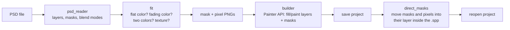

# Emil's PSD to Painter

A Substance 3D Painter plugin that takes your PSD layers and rebuilds them in Painter as layers you can actually edit. Every PSD layer becomes a fill layer with **one flat color** and a **mask** shaped like the original, and the mask lives *in* the layer, just like if you'd painted it by hand.

I made this because I had an avatar whose textures only came as Photoshop files (with Japanese layer names too, yay), and importing them into Painter by hand was wayyyy too long. Painter can only import a PSD as one flat image, so you lose every layer, and redoing them by hand is... yeah, no.

## What it does

- Reads the PSD itself (folders, visibility, opacity, blend modes, layer masks), no Photoshop needed
- Turns each layer into a flat color + mask, so changing a color is just picking a new one
- Layers that fade (shadows, lights) become one color + a soft mask, gradients become a little folder with two colors
- Layers that really have lots of colors in them (actual painting, not just a color) become **paint layers** holding the PSD pixels, so you can paint right over them
- Or tick one box and get everything as paint layers, if that's more your thing
- Translates the common Japanese layer names to English (レイヤー 3 → Layer 3, 影 → Shadow, ...)
- Skips helper layers like UV wireframes and guides (you can change the pattern)
- Puts the masks and the pixels directly in the layers, not as fill effects (see [the .spp part](#the-spp-part) for how)

## Install

1. Download the latest zip from [Releases](https://github.com/emil1326/EmilsPsdToSpp/releases) and unzip it.
2. Copy the `EmilsPsdToSpp` folder into Painter's plugins folder:
   - Windows: `Documents\Adobe\Adobe Substance 3D Painter\python\plugins\`
   - macOS: `~/Documents/Adobe/Adobe Substance 3D Painter/python/plugins/`
3. In Painter, open the **Python** menu and tick **EmilsPsdToSpp** (or restart Painter).

The first time you use it, it asks to download **numpy** (about 12 MB, from pypi.org), because Painter's Python doesn't come with it. It goes into the plugin's own folder, nothing else on your PC is touched.

## Use it

1. Open your project in Painter and save it once.
2. **File → Import PSD layers (Emil's)...**
3. Add your PSD files. Each one gets matched to the texture set with the closest name (`Head_PSD.psd` → `Head`), and you can change it in the list.
4. Hit **Import**.

Each PSD ends up in a folder called `PSD - <file name>` on top of the texture set's layers. With *Delete the texture set's existing layers first* ticked, everything already in that texture set goes away first, so use it on a copy if you're not sure.

With *Put masks and pixels directly in the layers* ticked (the default), the plugin saves the project, closes it, rewrites the file and opens it again. A backup of the project is kept next to it as `<project>.spp.bak`.

| Option | What it does |
|---|---|
| Skip layers matching | A regex, layers whose name matches are left out. Default skips `UV`, `UVMap`, `Guide(s)` and names ending in `_PNG` (flattened previews some PSDs ship with). Empty = keep everything |
| Color tolerance | How far (0-255) pixels can drift from the flat color(s) before a layer becomes a paint layer instead. Higher = more flat colors, less exact |
| Import every layer as a paint layer | Skips the flat color guessing, every layer becomes a paint layer with the exact PSD pixels |

## How it works

For every layer it tries, in order: one flat color, one color fading to the blend mode's neutral (white for Multiply, black for Screen), two colors with a gradient, and only then gives up and makes it a paint layer with the pixels. A guess counts if 99% of the layer's pixels land within the tolerance once the layer's opacity is applied.

## The .spp part

Painter's Python API can put a texture into a mask or a paint layer only as a *fill effect* stacked on top, which isn't what you get when you paint yourself. Your brush strokes live in a hidden group at the bottom of the mask (or of the paint layer's content). There's no API for that, so the plugin edits the saved `.spp` file directly: it moves each fill it made (named `PSD mask` and `PSD pixels`) into that hidden group, and that's it.

A `.spp` is an HDF5 file, and the layer stack is in `paint/document.bin`. This plugin reads and writes that format byte for byte (the reader is based on [SubCraft](https://github.com/Aalzard/subcraft)'s work, see credits). Painter also checks each part of the file against a MurmurHash3 x64_128 checksum with seed `0xF13A0239`. I had to find that seed by looking inside the Painter program, which is the only way to know it, since it isn't documented anywhere.

> **Heads up:** this rewrites an undocumented file format. It works on Painter 12.2 (2026), which is the one I tested, but a future Painter could change the format. If anything looks wrong, the plugin puts the backup back by itself, and the backup stays next to your project anyway. Use at your own risk, keep backups of stuff you care about, and know this project has nothing to do with Adobe.

If you'd rather not touch the file at all, untick the option. The masks and pixels then stay as fill effects, which look exactly the same, they just show up as an extra row.

## Limits

This is a first version, so expect a few rough edges. The PSD reading, the color fitting and the `.spp` rewrite are checked against reference tools (psd-tools, h5py) and give the exact same results, but the in-Painter part is fresh. If something breaks, [open an issue](https://github.com/emil1326/EmilsPsdToSpp/issues) with Painter's log (on Windows: `%LOCALAPPDATA%\Adobe\Adobe Substance 3D Painter\log.txt`) and I'll have a look.

- PSD only (no PSB), RGB or grayscale, 8 or 16 bits
- Clipping masks, layer styles (drop shadow, stroke...) and adjustment layers aren't converted, only the layer's own pixels and mask
- Only the Base Color channel is filled
- Painter blends in linear color, Photoshop doesn't, so semi-transparent Multiply layers can look a tiny bit different
- Tested on Windows with Painter 12.2. macOS should work but I haven't tried it

## Credits

- The `document.bin` reader is a Python port of the parser from [SubCraft](https://github.com/Aalzard/subcraft) by Aalzard and contributors, used under the MIT License (see [LICENSE-SUBCRAFT](LICENSE-SUBCRAFT)). I added the Painter 12.2 field type, the writer and the checksum.
- Thanks to [material-painter](https://github.com/alla2001/material-painter), which is how I found SubCraft's research in the first place.

## License

MIT + [Commons Clause](https://commonsclause.com/), see [LICENSE](LICENSE). In plain words:

- Use it for anything you want, paid commissions included
- Modify it, share it, fork it, go wild
- Just don't **sell the plugin itself** (or a paid thing that's basically this plugin)
- And don't use it to steal or resell other people's art, harass people, or do illegal stuff. Be nice :>

Technically that makes it "source-available" rather than official open source, but yeah, for a Painter plugin it doesn't change much.

Made by Emil :>
